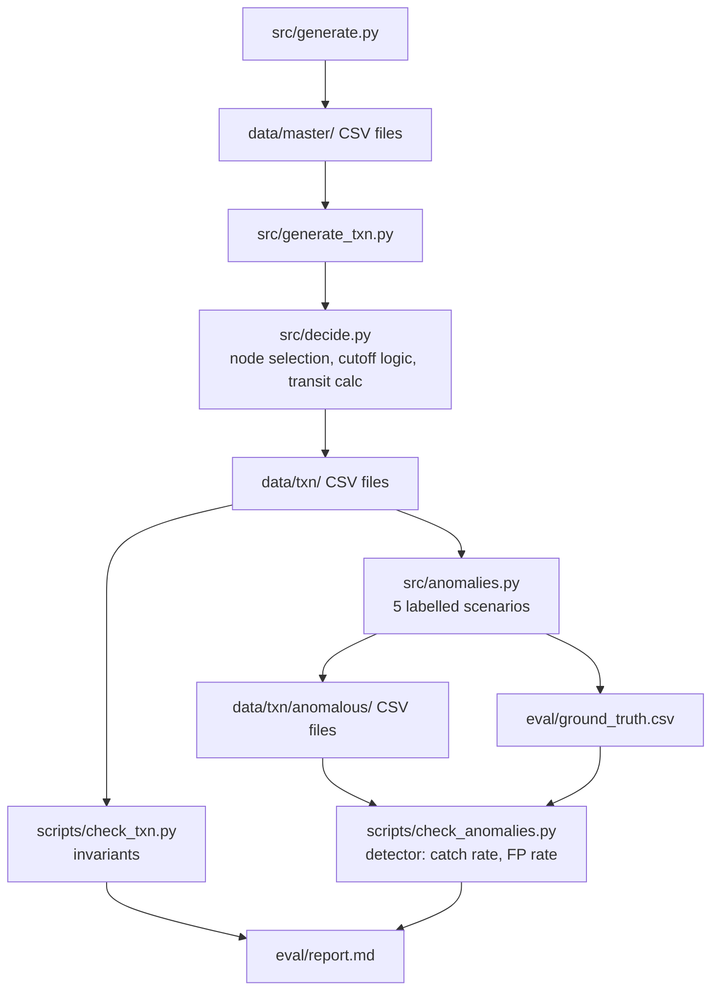

# Fulfillment Simulator

A reproducible synthetic-data generator, fulfilment decision engine, and
validation harness for the problem of selecting fulfilment nodes and
promise dates from inventory, warehouse capacity, carrier cutoffs, and
shipping service levels.

Everything is generated from a single fixed seed (`20261022`). Two runs
with the same seed produce byte-identical output. Every injected anomaly
is labelled in a separate ground-truth file, and a pure-function detector
catches all five required negative scenarios with zero false positives on
the clean set.

---

## The problem

A merchant receives an order. To promise a delivery date, the system must
decide **which fulfilment node(s) will ship it** and **when the customer
will receive it** — subject to four constraints that interact: whether the
node has the SKU in stock (after reservations and safety stock), whether
the node has capacity remaining that day, whether a carrier serving the
order's zone offers the requested service level and has not already passed
its cutoff, and what transit time that service level implies. Orders can
split across nodes. Some orders cannot be covered at all. The system must
expose every decision and every exception, preserve traceability, and
produce measurable outputs — not just plausible-looking data.

## The claim

- **Generation is reproducible.** `python -m src.generate --seed 20261022`
  and `python -m src.generate_txn --seed 20261022` produce byte-identical
  CSVs on every run, verified by SHA-256 manifest comparison
  (`scripts/reproduce.py`). Full scale is 50,000 orders, 20 nodes, 10
  carriers, and 220,870 tracking events.
- **Decisions are traceable.** Every shipment records the node that won
  it and the carrier that will serve it. Every promise records a
  `reason_code` (`single_node`, `split_node`, or `fallback`) and the node
  it is anchored to. Node selection is deterministic — highest available
  stock, then lexicographic node ID — so the same inputs always produce
  the same decision (D-04).
- **Exceptions are first-class.** Orders that cannot be covered by any
  node emit an explicit fallback promise and a flagged shipment
  (`is_fallback=true`). They are never silently dropped (D-03, D-06).
- **The anomaly suite is honest.** Five required negative scenarios are
  injected on top of the clean tables, each labelled in
  `eval/ground_truth.csv`. The detector catches 25/25 with 0 false
  positives, and the same detector on the clean set returns 0 detections.

## Architecture



The master layer is generated first, from nothing. The transaction layer
reads the master tables and produces orders, allocations, shipments,
promises, and tracking events. The decision engine is a pure function:
given the same master tables and the same order, it produces the same
shipment plan.
```
## Results


### Clean set — starter scale (2,000 orders)
```
OK  orders=2000 lines=4918 shipments=4925 promises=2000 tracking=24245
wrote eval/ground_truth.csv (25 rows)
  promise_before_order         5
  allocation_exceeds_stock     5
  carrier_zone_unsupported     5
  delivered_before_dispatch    5
  split_status_not_rolled_up   5

wrote data/txn/anomalous/*.csv
```


### Anomalous set — 5 injected scenarios per type
=== anomalous set ===
ground_truth rows : 25
detections        : 25
true positive     : 25
false positive    : 0
missed (FN)       : 0
catch rate        : 1.0000
FP rate           : 0.0000

clean set: 0 detections (OK)


### Full scale (`--scale full`, seed 20261022)
orders.csv rows= 50000 sha256=affeb494d2df
order_lines.csv rows= 124944 sha256=1795996a8059
shipments.csv rows= 125364 sha256=b58ca26d41c9
delivery_promises.csv rows= 50000 sha256=f470c2b0d42c
tracking_events.csv rows= 220870 sha256=c64614244a0a


| Entity | Required | Produced |
|---|---|---|
| Orders | 50,000 | 50,000 |
| Fulfilment nodes | 20 | 20 |
| Carriers | 10 | 10 |
| Tracking events | 100,000 | 220,870 |

Full output, including the full-scale timing note, is in
[`eval/report.md`](eval/report.md).

## Reproduce

Requires Python 3.11+ and a working `pip`. No external data, no API keys.

```bash
python -m venv .venv && source .venv/bin/activate   # Windows: .venv\Scripts\activate
pip install -r requirements.txt

# 1. master tables (seed, scale)
python -m src.generate --seed 20261022 --scale starter

# 2. transaction tables — decision engine runs inside this step
python -m src.generate_txn --seed 20261022 --scale starter

# 3. validate clean invariants (PK, FK, arithmetic, date ordering, tracking monotonic)
python scripts/check_txn.py

# 4. inject the five labelled anomaly scenarios
python -m src.anomalies

# 5. run the detector against ground truth (catch rate / FP rate)
python scripts/check_anomalies.py

# 6. prove reproducibility: two runs, compare manifests
python scripts/reproduce.py

Expected final line from step 6: REPRODUCIBLE: manifests identical.

A Makefile is provided for reviewers on systems with make; the
commands above are the primary, OS-agnostic path. On Windows, if CSV
writes are slow, the repository should live on a non-synced local
filesystem (see eval/report.md — "Environment note").


## Design decisions
```
Every decision that shaped the generator, engine, or validator is
recorded in docs/DECISIONS.md with the alternatives
that were rejected. The most material:

ID	Decision
D-01	Holiday capacity is 0, not a percentage reduction
D-02	Promise date uses transit_days_max (conservative)
D-03	Unfulfillable lines emit an explicit fallback promise
D-04	Node selection tie-break is deterministic (no RNG)
D-05	Actual delivery is fixed 36h post-dispatch, independent of SLA
D-06	Fallback shipments are flagged, not silently exempted
D-07	Anomaly suite runs at starter scale only
D-12	Reproducibility proven by DataFrame checksum, not file bytes
D-13	Stack is minimal: pandas, numpy, pydantic, faker, stdlib
```
Limitations

Stated plainly. These are not oversights; they are scope boundaries.

Synthetic data only. src/generate.py produces the corruption
model, so the reported catch rate is on this model, not on real
carrier feeds. Real feeds have shapes this generator does not cover:
line-level partial refunds, multi-currency settlement, correction
entries referencing prior settlements.

The tracking timeline is fixed (D-05). Actual delivery is 36h
after dispatch regardless of service level. A richer model would draw
delivery time from a distribution conditioned on carrier, zone, and
service level, with its own ground truth to validate.

Concurrency is not modelled. Capacity is reserved serially per
dispatch day. With a single-writer generator this is correct; a
concurrent deployment would need transactional reservation.

Fallback orders have no carrier-level SLA. By design (D-03, D-06)
— no carrier was assigned, so no SLA can be measured. Fulfilment rate
is measurable; carrier-level metrics are not, for that subset.

Built with
Designed and built with Claude and DeepSeek as pair-programming
partners. The data dictionary, the schema, the decision engine, the
anomaly injector, and the validation harness were written during a
72-hour challenge build; the models helped with debugging (pandas dtype
issues, Windows path handling, pydantic constraint ordering) and with
reviewing the design decisions against the problem statement. Every
design decision is in docs/DECISIONS.md, made deliberately and
defended there.